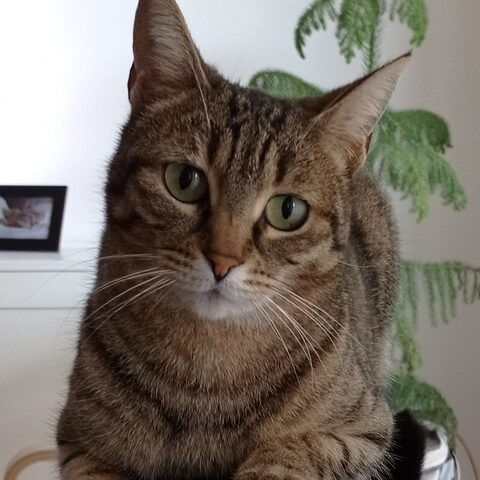

<p align="center"></p>

# FormatCraft

**A free, open-source media converter for Windows and macOS** — video, audio, images and PDF in one place, with the utilities you expect from an all-in-one converter like Format Factory: joiner, mux, splitter, screen recorder and media info.

Written in Rust. Audio and video are processed by [FFmpeg](https://ffmpeg.org), bundled in the installers and run as a separate program; images and PDFs are handled natively.

> 🇮🇹 **In italiano** — FormatCraft è un convertitore multimediale libero per Windows e macOS: converte video, audio, immagini e PDF, estrae l'audio da CD (file .cda) e DVD, unisce e divide file, sostituisce l'audio di un video, registra lo schermo e mostra le informazioni dei file. L'interfaccia è in italiano e in inglese.

## Download

Grab the latest build from [Releases](https://github.com/miniamoci-tech/formatcraft/releases):

| Platform | File |
|---|---|
| Windows 10/11 (x64) | `FormatCraft-<version>-windows-x64-setup.exe` |
| macOS 11+ Apple silicon | `FormatCraft-<version>-macos-arm64.dmg` |
| macOS 11+ Intel | `FormatCraft-<version>-macos-x86_64.dmg` |

The builds are not code-signed by a paid certificate yet:
- **Windows**: SmartScreen may say "Windows protected your PC" → *More info* → *Run anyway*.
- **macOS**: the app is ad-hoc signed but not notarised. The first time, right-click `FormatCraft.app` → *Open* → *Open* (or run `xattr -dr com.apple.quarantine /Applications/FormatCraft.app`).

## Features

| Area | What it does |
|---|---|
| **Video** | MP4 (H.264 / H.265), MKV, WebM (VP9), AVI, MOV, WMV, FLV, MPEG‑2, 3GP, OGV, MPEG‑TS, animated GIF / WebP. Quality presets, resolution presets or custom size, frame rate, bitrate, cut (start/end), crop, rotate/mirror, speed, volume, remove audio, image watermark. |
| **Audio** | MP3, AAC, M4A, M4R (iPhone ringtone), WAV, FLAC, OGG, Opus, WMA, AIFF, AC3, MP2, AMR, WavPack — from audio *or* video files (audio extraction). Bitrate, sample rate, channels, cut, speed, volume. |
| **Image** | JPG, PNG, WebP, BMP, GIF, TIFF, ICO, TGA, QOI, PPM. Resize, scale, rotate, grayscale, JPEG quality. HEIC/AVIF inputs are decoded through FFmpeg. |
| **PDF** | Merge, split into pages, compress, images → PDF. |
| **Disc** | Audio CD → MP3/FLAC/WAV/… (pick the `TrackNN.cda` files or detect the CD and tick tracks). DVD → audio (main title or a chosen title and language, from the drive, a `VIDEO_TS` folder or an `.iso`). Copy-protected commercial DVDs cannot be read. |
| **Utilities** | Video joiner (mixed sizes OK), audio joiner, mux (replace audio), splitter, screen recorder, media info. |
| **Workflow** | Task list with parallel conversions, progress, stop/retry, drag & drop, "Open with", output to a folder or next to the source. Never overwrites existing files. |

See [`parity/formatfactory-features.toml`](parity/formatfactory-features.toml) for the honest feature checklist and [`docs/gaps.md`](docs/gaps.md) for what is missing.

## Command line and automation

Everything the app does is also available headlessly:

```bash
formatcraft-cli convert holiday.mkv --to mp4 --out converted --options '{"quality":"high","width":1280}'
formatcraft-cli probe holiday.mkv
formatcraft-cli tools
formatcraft-cli run --script steps.json --root ./work
```

`steps.json`:

```json
{"steps":[
  {"tool":"convert","args":{"input":"clip.mov","format":"gif","options":{"width":480,"start":2,"end":6}}},
  {"tool":"join","args":{"inputs":["a.mp4","b.mp4"],"format":"mp4","output_dir":"out"}},
  {"tool":"pdf_merge","args":{"inputs":["a.pdf","b.pdf"]}}
]}
```

Paths in scripts are confined to `--root`.

## Building

```bash
cargo run -p formatcraft            # desktop app (needs FFmpeg on PATH for audio/video)
cargo test --workspace              # unit + FFmpeg end-to-end tests
cargo xtask dist-windows            # Windows installer (needs Inno Setup 6)
cargo xtask dist-macos aarch64-apple-darwin   # DMG (on macOS)
```

Releases are built by GitHub Actions ([`.github/workflows/release.yml`](.github/workflows/release.yml)) when a `v*` tag is pushed.

## Project layout

```
crates/engine      formats, jobs, FFmpeg runner, images, PDF, queue (no UI)
crates/automation  headless tool table with --root confinement
crates/cli         formatcraft-cli
crates/app         the egui desktop app
xtask              icon, asset check, packaging
installer/         Inno Setup script, macOS Info.plist
```

Contributors and agents: read [`AGENTS.md`](AGENTS.md) and [`CLAUDE.md`](CLAUDE.md) first.

## 🐱 Support the Project (and the Cat Fleet!)

This project is completely free, open source, and developed with an AI-driven approach. While the code is crafted with the help of AI agents, the quality control is managed by three real-life supervisors:

| **Drugo** | **Elia** | **Nancy** |
| :---: | :---: | :---: |
|  |  |  |
| *The Senior Consultant* | *The Quality Assurance Analyst* | *The Undercover Operations Manager* |
| Our wisest and oldest cat. He oversees structural decisions with calm. | Powered exclusively by *Catisfaction* treats. If the code compiles, he purrs. | She monitors the repository from her secret base under the bed. |

👉 [**Buy Elia some Catisfaction on Ko-fi**](https://ko-fi.com/minatore)

## Licence

FormatCraft is licensed under **MIT OR Apache-2.0**. Bundled FFmpeg binaries are GPL and are distributed as separate programs; see [`NOTICE`](NOTICE) and [`ATTRIBUTION.toml`](ATTRIBUTION.toml).

FormatCraft is an independent project and is not affiliated with Format Factory or PCFreetime.
